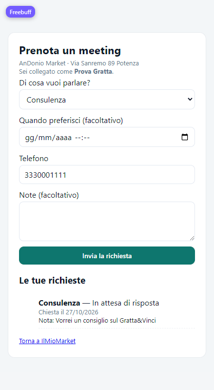
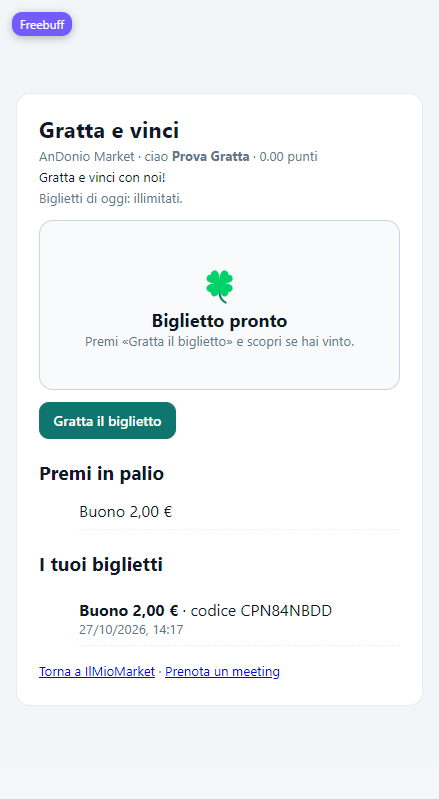

# Manuale utente — AnDonio Market

Manuale completo del gestionale **AnDonio Market** e del sito del negozio.
Va bene sia per la versione **Illimitato** (quella del negozio) sia per le
versioni con **licenza** (Cassa Libera, Cassa & Catalogo, Magazzino, Negozio,
Completo): le funzioni sono le stesse, la chiave di licenza decide quali si
aprono.

Indice:

1. [Installazione e primo avvio](#1-installazione-e-primo-avvio)
2. [La cassa](#2-la-cassa)
3. [Prodotti, magazzino ed etichette](#3-prodotti-magazzino-ed-etichette)
4. [Clienti, tessere e compleanni](#4-clienti-tessere-e-compleanni)
5. [Appuntamenti dal sito](#5-appuntamenti-dal-sito)
6. [Gratta e vinci](#6-gratta-e-vinci)
7. [Offerte del giorno e sconti](#7-offerte-del-giorno-e-sconti)
8. [Coupon, buoni regalo e punti](#8-coupon-buoni-regalo-e-punti)
9. [Ordini con ritiro](#9-ordini-con-ritiro)
10. [Self-checkout](#10-self-checkout)
11. [Riconoscimento del volto](#11-riconoscimento-del-volto)
12. [Sito del negozio](#12-sito-del-negozio)
13. [Sincronizzazione con il sito](#13-sincronizzazione-con-il-sito)
14. [Backup](#14-backup)
15. [Domande frequenti](#15-domande-frequenti)

---

## 1. Installazione e primo avvio

### Cosa scaricare

| File | A cosa serve |
|---|---|
| `AnDonioMarket_Setup.exe` | **Consigliato.** Installa il programma per l'utente corrente (non serve essere amministratore), crea i collegamenti nel menu Start e sul Desktop. |
| `AnDonioMarket.exe` | Versione **portabile**: un solo file, non si installa. Mettilo in una cartella e fai doppio clic. |

Requisiti: Windows 10 o 11 a 64 bit. Internet serve la prima volta per
attivare la licenza; poi il programma funziona anche senza connessione.

### Attivazione della licenza

1. Apri il programma.
2. Inserisci la chiave ricevuta (formato `ANDM-XXXXX-XXXXX-XXXXX-XXXXX`) e premi
   **Attiva licenza**. I trattini si possono anche omettere.
3. La chiave viene legata a quel computer. Per spostarla su un altro PC scrivi
   all'assistenza: viene sbloccata e la riattivi sul computer nuovo.

Il programma ricontrolla la licenza all'avvio e poi ogni 15 minuti. Se il PC
resta offline hai 30 minuti di tempo per tornare online; dopo, il programma si
blocca finché non torna la connessione.

### Dove finiscono i dati

Tutti i dati restano sul tuo computer, accanto al programma:

```
data\        prodotti, clienti, storico, punti, utenti, regole, cassa
SCONTRINI\   documenti TXT e PDF
BACKUP\      backup automatici e manuali
logs\        registro tecnico
```

Disinstallare il programma **non** cancella i dati.

### Le schede del programma

In alto ci sono i pulsanti di servizio (**Oggi**, **Self-checkout**, **Coda**,
**Apri cassa**), sotto le schede:

- **Cassa** — le vendite.
- **Prodotti** — catalogo, giacenze, etichette.
- **Sconti** — sconti temporanei, bundle, scadenze.
- **Clienti** — anagrafica, punti, tessere, compleanni.
- **Scontrini** — storico e ristampa.
- **Statistiche** — incassi, esportazioni, report IVA.
- **Registro**, **Utenti**, **Impostazioni** (solo amministratore).
- **Appuntamenti** — le richieste di meeting arrivate dal sito.
- **Gratta&Vinci** — regole del gioco, premi in palio e premi da ritirare.

---

## 2. La cassa

### Una vendita normale

1. Cerca il prodotto per nome, scansiona il codice a barre con lo scanner o
   premi **F4** per usare la fotocamera.
2. I prodotti finiscono nel carrello; con **F1** si salta alla ricerca.
3. Se il prodotto è **a peso**, il programma chiede i kg.
4. Premi **F8** (o **Emetti documento**) per chiudere lo scontrino.

Nella colonna destra della cassa trovi cliente, punti, buoni regalo, offerte e
coupon.

### Cliente e punti

- Scansiona la tessera, digita il **codice cliente** oppure premi
  **🙂 Riconosci cliente dal volto**.
- Il codice cliente si può scrivere come vuoi: `201307`, `2013 07` o
  `20-13-07` funzionano tutti, perché il confronto ignora spazi e trattini.
- Se il cliente è registrato al sito, i punti si allineano da soli alla
  sincronizzazione.

### Sconti, buoni, coupon e offerte

- **🏷️ Offerta di oggi** — applica i prodotti dell'offerta del giorno con il
  loro prezzo scontato (vedi [capitolo 7](#7-offerte-del-giorno-e-sconti)).
- **🎟️ Applica coupon** — scansiona un codice `CPN…` (compleanno, benvenuto,
  inattivi, Gratta&Vinci): lo sconto si applica subito e il coupon risulta usato
  sullo scontrino.
- **Buoni regalo** (`BUO…`) — scalano dal saldo del buono.
- **🎲 Biglietto fortunato** — uno sconto a sorpresa sulla vendita.
- I **premi del Gratta&Vinci** sono coupon come gli altri: il cliente ti mostra
  il codice `CPN…` e lo sconto si applica da solo.
- **Codici creati online**: se scrivi o scansiona un codice `BUO…`, `GRA…` o
  `CPN…` che la cassa non ha ancora ricevuto con la sincronizzazione, il
  programma lo chiede al sito e lo applica subito. Non serve far rifare il
  codice al cliente né ricaricare la pagina del pannello. Il saldo dei buoni e
  i premi consegnati restano allineati da sole due parti.

### Ritiro di un ordine del sito

1. Scansiona il codice `ORD…` nella cassa.
2. Il programma carica da solo i prodotti e il cliente dell'ordine.
3. Premi **Emetti documento**: l'ordine passa a *Ritirato* con il numero dello
   scontrino.

### Metodi di pagamento, resto e fattura

- Scegli il metodo (contanti, carta, bancomat, buoni…) e, con i contanti,
  scrivi l'importo ricevuto: il resto viene calcolato da solo.
- Con un cliente che ha **P.IVA / C.F.** spunta **📄 Emetti fattura**: il
  documento è intestato a suo nome, con numerazione propria (`1/2026`, …) che
  riparte da 1 ogni anno.

### Scontrini sospesi e ristampe

- **F2 Sospendi scontrino** mette da parte il carrello, **F3 Riprendi scontrino**
  lo riprende (utile quando il cliente dimentica qualcosa).
- Dalla scheda **Scontrini** cerchi un documento passato e lo ristampi in TXT o
  PDF, oppure ne fai uno **storno** (reso).

---

## 3. Prodotti, magazzino ed etichette

Nella scheda **Prodotti**:

- **Nome, prezzo, IVA, giacenza, barcode** (se lo lasci vuoto il programma
  genera un EAN-8), **costo**, **scorta minima**, **lotto** e **scadenza**.
- **Giacenza illimitata** per i prodotti che non vuoi contare.
- **A peso** per frutta, verdura e sfusi: in cassa si chiedono i kg.
- Da qui si possono anche **importare** ed **esportare** i prodotti in CSV.

**🏷️ Etichette prezzo (PDF A4)** stampa cartellini con nome, prezzo, nome del
negozio e barcode Code128, tre per riga: puoi stampare i prodotti selezionati,
tutti, oppure solo quelli sotto scorta minima.

**📦 Inventario** apre il conteggio guidato: si scansiona quello che c'è nella
scaffale e il programma calcola le differenze con la giacenza a sistema, poi
allinea con un pulsante.

I prodotti vicini alla **scadenza** finiscono nella bacheca **📌 Oggi** e possono
essere scontati in automatico con la regola impostata in *Sconti*.

---

## 4. Clienti, tessere e compleanni

Ogni scheda cliente ha: nome, email, telefono, **codice cliente**, **P.IVA /
C.F.**, **data di compleanno**, punti e **tessera fedeltà** (EAN-8).

- **Codice cliente**: è il codice che il cliente vede nel sito come "Codice
  cliente" e che si può digitare in cassa. È quello scritto nel tuo programma:
  alla sincronizzazione la sua versione vince su quella del sito. Se un altro
  cliente del sito (o uno importato da Loyverse) aveva lo stesso codice, dopo la
  sincronizzazione vale il tuo e il codice resta su una sola scheda.
- **Tessera fedeltà**: il programma assegna un EAN-8 (`2000…`) a ogni cliente.
  Si stampa la tessera, si mostra il codice a barre oppure il **QR** dal sito.
- **Compleanno** (formato `GG/MM` o `MM-GG`): il giorno stesso il sito crea in
  automatico il coupon di compleanno con lo sconto che hai impostato e lo invia
  per email al cliente.
- **Punti**: si assegnano alla vendita (1 punto per euro, configurabile) e si
  possono correggere a mano dal pulsante **Modifica punti**.
- **Codice invito** e **invitato da**: per il programma referral (punti a chi
  invita e a chi si iscrive).

---

## 5. Appuntamenti dal sito

I clienti registrati al sito possono chiedere un **meeting** dal negozio.

### Dal lato cliente — pagina `/prenota`



1. Il cliente apre `/prenota` e fa **accesso** con l'account del sito (è
   obbligatorio: così la richiesta arriva con nome, email e telefono già
   verificati).
2. Sceglie **l'argomento** (Consulenza, Problema con un ordine, Assistenza
   prodotto, Altro), **quando preferisce** (facoltativo), il **telefono** e
   scrive le **note**.
3. Premendo **Invia la richiesta** compare sotto l'elenco **Le tue richieste**
   con lo stato: *In attesa*, *Confermato*, *Annullato*, *Fatto*, insieme alla
   risposta del negozio.
4. Ogni cliente può avere al massimo **tre richieste aperte**: evita di
   riempire l'agenda con lo stesso appuntamento.

### Dal lato negozio — scheda **Appuntamenti**

Nell'app del negozio c'è la scheda **Appuntamenti** con l'elenco delle
richieste (data, cliente, telefono, argomento, preferenza, stato, note) e i
pulsanti:

- **🔄 Aggiorna dal sito** — scarica subito le richieste nuove.
- **✅ Conferma** — il cliente legge *Confermato*.
- **❌ Annulla** — la richiesta sparisce dall'elenco.
- **✔️ Fatto** — meeting concluso.
- Nel campo **Risposta al cliente** puoi scrivere un messaggio (per esempio
  l'orario concordato): arriva nell'area personale del cliente.

Le richieste arrivano anche da sole con la **sincronizzazione** (all'avvio del
programma e con **☁ Sincronizza tutto col sito**), quindi non serve tenere
aperto il pannello web.

### Dal lato negozio — pannello web

Nel pannello del sito c'è la voce **📅 Appuntamenti** (solo amministratore),
con il badge del numero di richieste **da rispondere**: stessi dati dell'app
(cliente, telefono, argomento, note, preferenza, stato) e gli stessi pulsanti
**Conferma**, **Fatto**, **Annulla** e **Rispondi** con il messaggio per il
cliente. L'elenco delle richieste concluse non ingombra: restano solo quelle
ancora aperte.

---

## 6. Gratta e vinci

Il sito ha una pagina **`/grattasubito`** dove i clienti registrati grattano un
biglietto virtuale: se vincono, il premio finisce sulla loro carta fedeltà.



### Dal lato cliente

1. Il cliente apre `/grattasubito` e fa **accesso** (senza account non si può
   grattare: il premio deve poter arrivare sulla sua carta).
2. Vede il **messaggio del negozio**, quanti **biglietti gli restano oggi** e
   l'elenco dei **premi in palio**.
3. Premendo **Gratta il biglietto** il programma decide subito l'esito; il
   biglietto si scopre grattando con il dito o con il mouse (o premendo
   **Scopri subito**).
4. Se ha vinto:
   - per uno **sconto** compare un codice `CPN…`: il cliente lo mostra alla
     cassa e lo sconto si applica scansionandolo;
   - per **punti** il saldo della carta aumenta subito;
   - per un **premio in natura** compare un codice `GRA…` da mostrare alla
     cassa, dove il negozio lo segna come ritirato.
5. Tutti i biglietti grattati restano in **I tuoi biglietti**, con il premio,
   il codice e la data.

### Dal lato negozio — scheda **Gratta&Vinci**

Nell'app trovi due parti.

**Regole del gioco** (solo amministratore):

| Impostazione | Cosa fa |
|---|---|
| Gioco attivo | Spegne o accende il gioco sul sito. |
| Probabilità di vincita % | Quante possibilità su 100 ha ogni biglietto di vincere (per esempio 25). |
| Biglietti al giorno per cliente | Quanti biglietti può grattare ogni cliente in un giorno (0 = senza limite). |
| Biglietti totali al giorno | Limite per tutto il negozio (0 = senza limite). |
| Premi al giorno per cliente | Quante volte al giorno lo stesso cliente può vincere (0 = senza limite). |
| Pausa dopo una vincita | Quanti biglietti bisogna grattare dopo un premio prima di poter vincere di nuovo. |
| Messaggio in cima alla pagina | Il testo che i clienti leggono sulla pagina del gioco. |

**Premi in palio** — quanti premi vuoi, ognuno con:

- **Nome** (per esempio "Buono 5 euro");
- **Tipo**: *Sconto in percentuale*, *Sconto in euro*, *Punti fedeltà*,
  *Premio in natura (omaggio)*;
- **Valore** (la percentuale, gli euro o i punti);
- **Peso**: quanto è probabile che esca rispetto agli altri premi (peso 60 esce
  molto più spesso di peso 5);
- **Massimo al giorno** (0 = senza limite) e **valido per giorni** (la scadenza
  del coupon creato);
- **Messaggio al cliente** e interruttore **Premio attivo**.

Premi **💾 Salva e invia al sito**: le regole vengono salvate nel programma e
mandate al sito, quindi valgono per il sito e per tutte le casse collegate.

**Premi vinti da ritirare** — l'elenco dei premi consegnabili (cliente, premio,
codice, email, data). Il pulsante **🔄 Aggiorna dal sito** li scarica subito e
**✅ Premio ritirato** segna il premio scelto come consegnato (e lo toglie
dall'elenco anche sul sito).

### Dal lato negozio — pannello web

Nel pannello del sito c'è la voce **🎰 Gratta e vinci** (solo amministratore):
le stesse impostazioni dell'app (gioco attivo, probabilità di vincita, gratta al
giorno per ogni cliente e per tutto il negozio, vincite al giorno, pausa dopo
una vincita, testo mostrato al cliente) e la tabella dei **premi in palio**
(nome, tipo, valore, peso, al giorno, validità, attivo), con **+ Aggiungi
premio** e **✕** per togliere un premio. Il pulsante **Salva tutto** manda le
regole al sito e a tutte le casse collegate.

Sotto, la parte **Oggi**: quanti biglietti sono stati grattati, quanti hanno
vinto e quanti premi sono **da consegnare**, con il pulsante **Consegnato** per
segnarli (l'elenco si aggiorna anche in cassa e nell'app).

---

## 7. Offerte del giorno e sconti

### Le nove offerte

Nella scheda **Offerte** del pannello (e nelle regole del programma) decidi
tutto, offerta per offerta:

- **Attiva / disattiva** la singola offerta.
- **Tipo**: percentuale oppure **importo fisso in euro**.
- **Valore**: la percentuale (o gli euro) da scontare.
- **Prodotti**: quali prodotti possono andare in quell'offerta (vuoto = tutti).
- **Quantità**: quanti prodotti mettere nell'offerta.
- **Peso manuale**: include anche i prodotti a peso.
- **Scadenza**: giorno e ora in cui l'offerta smette di valere (vuoto = fine
  giornata).
- Con **Ctrl/Shift** puoi selezionarne più di una e **attivare**,
  **disattivare** o dare la **stessa scadenza** in un colpo solo.

Dopo l'ora impostata (di base le **10:00**) il sistema genera da solo le offerte
del giorno e un **codice `OFF…`** per ciascuna, senza che nessuno apra il
programma o il pannello. Se l'invio email è attivo, i clienti iscritti ricevono
l'elenco in automatico (una sola volta al giorno).

Alla cassa si scansiona il codice `OFF…` e lo sconto si applica **solo a quei
prodotti**, per quella vendita, finché l'offerta non è scaduta. Un'offerta
spenta o scaduta viene rifiutata anche se il codice è ancora in giro.

I prezzi dell'elenco sono sempre quelli **attuali del catalogo**, non quelli
salvati il giorno in cui l'offerta è nata: l'email che ricevono i clienti, il
cartello che copi dal pannello e quello che vede la cassa mostrano perciò gli
stessi importi del negozio, anche se nel frattempo un prezzo è stato corretto.

### Sconti temporanei, bundle e scadenze

- **Sconti temporanei**: prezzo scontato su un prodotto per un periodo, con
  data di inizio e fine. Si applicano da soli in cassa e si vedono nel sito.
- **Bundle** (promozioni): *Prendi N, paghi N-1*, *secondo articolo scontato*,
  *gruppo a prezzo fisso*, scegliendo i prodotti.
- **Scadenze**: sconto automatico sui prodotti vicini alla scadenza.

Tutte queste regole si sincronizzano **a due vie** con la dashboard: vince
l'ultima modifica, da qualunque parte sia stata fatta.

---

## 8. Coupon, buoni regalo e punti

- **Coupon** (`CPN…`): compleanno, benvenuto, clienti inattivi, Gratta&Vinci e
  coupon manuali in euro o in percentuale. Si creano dal pannello *Coupon* e si
  applicano in cassa scansionandoli.
- **Buoni regalo** (`BUO…`): si vendono con un importo, hanno un saldo che
  scala a ogni uso e una scadenza.
- **Tutti i codici valgono in entrambi i posti**: un codice creato nel pannello
  web (coupon di compleanno, buono regalo, premio del Gratta&Vinci) funziona
  anche nella cassa del programma desktop e viceversa. Basta scriverlo o
  scansionarlo: se non è già arrivato con la sincronizzazione, la cassa lo
  legge dal sito al momento. Il saldo dei buoni e i premi già consegnati non si
  possono usare due volte.
- **Punti fedeltà**: si accumulano alla cassa (1 punto per euro, configurabile),
  si possono spendere come sconto e si vedono nell'area del cliente.
- **Referral**: chi invita un amico prende punti, chi si iscrive con il codice
  anche (valori configurabili).

---

## 9. Ordini con ritiro

Il cliente riempie il carrello su `/listaprodotti` e preme **Ordina e ritira in
negozio**: riceve un codice `ORD…` con il suo codice a barre, lo trova anche in
IlMioMarket e può mostrarlo dal telefono.

Il negozio lo vede nella pagina **Ordini** del pannello (e riceve una email) e
può segnarlo *In preparazione* o *Pronto*: al cliente arriva l'avviso. Alla
cassa, in versione **Illimitato**, si scansiona il codice e il carrello si
carica da solo.

---

## 10. Self-checkout

Dalla barra in alto premi **🛒 Self-checkout**: si apre una schermata sola a
tutto schermo, pensata per il cliente, con:

- **prodotti** (ricerca o scansione con la fotocamera, anche dal telefono con
  Iriun Webcam);
- **carrello** e totale;
- **riconoscimento del volto** per prendere la tessera fedeltà;
- **ritiro di un ordine** fatto dal sito (codice `ORD…`);
- **metodo di pagamento** (carta o contanti, con importo ricevuto e resto);
- **anteprima dello scontrino** e pulsante per emetterlo.

I pulsanti sono grandi e restano visibili anche sugli schermi piccoli. Per
uscire serve il **PIN di un amministratore**: il cliente non può chiudere la
postazione.

---

## 11. Riconoscimento del volto

In **Impostazioni → 🙂 Riconoscimento volto clienti** registri il volto di un
cliente (una quindicina di foto dalla webcam). Poi in cassa basta premere
**🙂 Riconosci cliente dal volto** e il cliente viene selezionato da solo.

Funziona con la webcam del PC oppure con **Iriun Webcam**: apri l'app sul
telefono, collegalo alla stessa Wi-Fi e il programma usa "Iriun Webcam" da solo
(lo stesso vale per Camo Studio e DroidCam). Le foto restano solo su quel
computer, in `data\volti`. La **soglia** (30 = severa, 130 = permissiva) si
regola dalle stesse impostazioni.

---

## 12. Sito del negozio

Indirizzo di base: `https://iltuosito.freebuff.page`. Le pagine pubbliche e
private sono:

| Pagina | A cosa serve |
|---|---|
| `/listaprodotti` | **Listino** per i clienti registrati: prezzi, prezzo scontato, disponibilità, carrello e ordine per il ritiro. |
| `/ilmioarket` | **IlMioMarket**: carta fedeltà (codice a barre e QR), punti, coupon, ordini, dati del profilo, carrello salvato. |
| `/prenota` | **Prenota un meeting** con il negozio. |
| `/grattasubito` | **Gratta e vinci**: un biglietto al giorno (o quanti ne concedi). |
| pannello del negozio | Cassa web, prodotti, clienti, coupon, offerte, ordini, promo, licenze, impostazioni e backup cloud. |

Alla registrazione, se il cliente scrive il numero di una tessera che esiste già
(anche con spazi, per esempio `2000 0066`), l'account viene collegato a quel
cliente e ai suoi punti.

---

## 13. Sincronizzazione con il sito

La sincronizzazione funziona nei due sensi e parte da sola all'avvio del
programma, oltre che col pulsante **☁ Sincronizza tutto col sito**.

### Come si configura

1. Nel programma apri **Clienti → ⚙️ Impostazioni sincronizzazione sito**
   (oppure *Impostazioni → Sincronizzazione gestionale desktop*).
2. Incolla il **token** che trovi nel pannello del sito in *Impostazioni →
   Sincronizzazione gestionale desktop* (pulsante **Copia token**). L'indirizzo è
   già compilato.
3. Premi **Verifica collegamento**: deve rispondere «Collegamento riuscito» con
   il numero di clienti e prodotti del sito.

Nel campo **Indirizzo del sito** va solo l'indirizzo; se incolli per errore un
indirizzo che finisce con `/api/sync/...` il programma lo corregge da solo.

### Cosa viaggia (nei due sensi)

- **Prodotti**: nome, prezzo, IVA, giacenza, barcode, a peso, eliminazioni.
- **Clienti**: anagrafica, **codice cliente**, tessera, **compleanno**,
  P.IVA, punti, inviti.
- **Sconti temporanei** e sconti rimossi.
- **Scontrini** emessi fuori tavola e **registro attività**.
- **Regole di sconto**: offerte (le nove, con scadenze e prodotti), bundle,
  buoni, promo, referral, coupon di compleanno, **regole del Gratta&Vinci**.
- **Buoni regalo** (importo, saldo, scadenza).
- **Appuntamenti**: le richieste di meeting dal sito.
- **Premi del Gratta&Vinci** vinti e ancora da ritirare.

Per ogni voce **vince la modifica più recente**, da qualunque parte sia stata
fatta; le eliminazioni viaggiano come "pietre tombali" così non vengono
ricreate.

### Il codice cliente vince sempre

Il **codice cliente** impostato nel tuo programma è la fonte: alla
sincronizzazione sostituisce quello scritto sul sito, e da quel momento vale
ovunque (cassa, pannello, area del cliente). Scrivendo il codice in cassa puoi
usare indifferentemente il codice cliente o il numero della tessera, con o senza
spazi e trattini.

### Il token

Il token permette **solo** di leggere e aggiornare i dati di negozio (clienti,
punti, prodotti, scontrini, regole, appuntamenti e premi); non dà accesso alla
cassa web, alle licenze o alle impostazioni del sito. Se lo rigeneri dal
pannello, aggiornalo nel programma.

---

## 14. Backup

Tre livelli, tutti attivi di default:

1. **Backup locale** — in `BACKUP\`, all'apertura del programma e ogni 15
   minuti; i vecchi backup non vengono sovrascritti.
2. **Backup su Google Drive** — la prima volta che usi il pulsante
   **☁️ Collega Google Drive** il programma chiede il permesso e crea la
   cartella **AnDonio Market Backup** nel tuo Drive. Da quel momento salva una
   copia **all'apertura** e **ogni 15 minuti**, ognuna in una sottocartella
   nuova con giorno, mese, anno, ora, minuti e secondi (per esempio
   `27-10-2026_15-20-45`): nessun backup precedente viene mai sovrascritto.
   Si accende o spegne da **Impostazioni & Backup**.
3. **Backup sul sito** — una volta al giorno il programma carica sul sito lo
   stesso ZIP dei backup locali (mai il file `.env`). Dal pannello web,
   *Impostazioni → Backup cloud*, si scarica l'ultimo file per ripristinarlo da
   **Ripristina da file…** se il PC si guasta. Il sito tiene gli ultimi 14
   backup.

---

## 15. Domande frequenti

**Ho dimenticato la password del pannello web.**
Serve il codice di recupero (in *Impostazioni → Cambia codice di recupero* del
programma) oppure scrivi all'assistenza.

**La cassa dice "Codice non trovato" quando scrivo il codice cliente.**
Adesso il codice si confronta ignorando spazi e trattini: scrivi `201307`,
`2013 07` o `20-13-07` e funziona. Se ancora non lo trova, controlla che il
cliente esista (anche dopo una sincronizzazione) e che quel codice sia davvero
il suo **Codice cliente**.

**Ho sbagliato il codice cliente sul sito.**
Correggilo nel programma (scheda *Clienti*): alla sincronizzazione successiva la
versione del programma vince.

**I prezzi nell'email delle offerte erano sbagliati.**
È stato corretto: adesso i prezzi sono formattati in centesimi in modo unico
(`€1,35 invece di €1,50`) e c'è un controllo automatico che impedisce il ritorno
dell'errore.

**Non vedo le richieste di meeting.**
Controlla che la sincronizzazione sia configurata (token) e premi **🔄 Aggiorna
dal sito** nella scheda *Appuntamenti*. I clienti devono essere registrati al
sito: senza account la richiesta non parte.

**Un cliente dice di aver grattato ma non vedo il premio.**
Nella scheda *Gratta&Vinci* premi **🔄 Aggiorna dal sito**: il premio appare in
*Premi vinti da ritirare*. Se il cliente ha vinto uno sconto, il codice è anche
un coupon: te lo mostrerà alla cassa e lo scanner lo applica da solo.

**Il gioco non fa vincere nessuno.**
Guarda la **probabilità di vincita** (per esempio 25 = 1 biglietto su 4), il
limite di **premi al giorno per cliente** e la **pausa dopo una vincita**: sono
le tre regole che riducono le vincite.

**Ho spostato il programma su un altro PC.**
Installa di nuovo, attiva la licenza (dopo averla fatta sbloccare) e usa
**Ripristina da file…** con l'ultimo backup.

---

## Supporto

Problemi, licenze, upgrade di versione: **andonio2013@gmail.com**

---

*In questo repository non sono pubblicate chiavi di licenza, dati dei clienti né
il codice sorgente del programma.*
